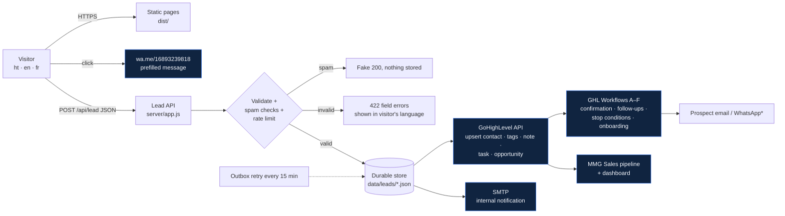

# Architecture — Mithoo Media Group platform

## 1. Recommendation: Hybrid (custom static site + GoHighLevel as the sales engine)

| Layer | Choice | Why |
|---|---|---|
| Public website | Pre-rendered static HTML/CSS/JS generated from templates + JSON content (this repo) | Fastest possible pages, no plugin attack surface, full design control, trilingual SEO URLs, no monthly CMS fee |
| Lead API | Small Node.js server (`server/`), zero framework, 1 runtime dependency (`nodemailer`) | Secrets stay server-side, server-side validation, spam protection, rate limiting, **durable write-ahead store so no lead is ever lost** |
| CRM / pipeline / automation | **GoHighLevel** sub-account "Mithoo Media Group" (`7YAqeIgL5dKqfWiT7NUN`) — *already owned and connected* | Pipeline, tasks, email/SMS/WhatsApp workflows, booking calendars, reporting dashboard, unsubscribe handling — no need to rebuild any of it |
| Email | GHL workflows for prospect emails (deliverability + unsubscribe); SMTP from the server for the internal backup notification | One sender per message type, no duplicates |
| WhatsApp | `wa.me` click-to-chat (live now); automated messages only via GHL's WhatsApp integration once approved | Honest split between "link" and "API" |

### Options considered

| Criterion | A. WordPress-first | B. GHL-first (GHL Sites/Funnels) | **C. Hybrid (chosen)** |
|---|---|---|---|
| Cost | Hosting $10–30/mo + premium plugins/theme | Included in GHL plan | Hosting ~$7–8/mo (estimate) + existing GHL plan |
| Reliability | Plugin/update conflicts are the #1 failure source | High (managed) | High: static files + one tiny API process |
| Maintainability | Core + theme + plugin updates weekly | Low effort | Low: no plugins; content in JSON |
| Design flexibility | Theme-bound unless custom theme | Builder-bound, hard to hit a custom editorial design | Full |
| SEO / hreflang | Needs WPML/Polylang (paid) for 3 languages | Weak multilingual support | Native per-language URLs, hreflang, sitemap |
| Form security | Plugin-dependent | Good | Server-validated, honeypot + timing + rate limit + optional Turnstile |
| Deliverability | Needs SMTP plugin | Good (LC Email) | Good (GHL for prospects, SMTP for internal) |
| Vendor lock-in | Low | High (site lives inside GHL) | Low for site; CRM swappable via one adapter file |
| Owner content editing | Best (wp-admin) | Good (builder) | JSON files via GitHub web editor (see OWNER-GUIDE). A visual CMS (Decap) can be added later |

**Trade-off we accept:** content editing is done by editing structured JSON files (in GitHub's web editor) rather than a WYSIWYG admin. In exchange, the site has no plugin maintenance, no admin login to attack, and builds fail loudly if a translation is missing.

## 2. Platform diagram

\* WhatsApp automation requires GHL's WhatsApp (Meta Business) integration — not active yet.

## 3. Sitemap & URLs

| Page | Kreyòl (default) | English | Français |
|---|---|---|---|
| Home (all sections + form) | `/` | `/en/` | `/fr/` |
| Privacy | `/konfidansyalite/` | `/en/privacy/` | `/fr/confidentialite/` |
| Terms | `/kondisyon/` | `/en/terms/` | `/fr/conditions/` |
| 404 (trilingual) | any unknown path | | |
| SEO | `/sitemap.xml` (with hreflang), `/robots.txt` | | |

Homepage anchors (same in all languages): `#services`, `#ecommerce`, `#process`, `#results`, `#about`, `#start` (form), `#contact`.

## 4. Data model

**Lead record** (`data/leads/<uuid>.json`, mode 0600, also mapped into GHL):

| Field | Type | GHL destination |
|---|---|---|
| id | UUID (client idempotency key) | note "Reference" |
| fullName, email, phone (E.164), businessName | string | standard contact fields |
| contactMethod (`email·whatsapp·phone`), language (`ht·en·fr`) | enum | MMG Preferred Contact Method, Ki lang ou prefere, tags `contact-*`, `lang-*` |
| industry, website, stage, goal | string/enum | MMG Industry, MMG Website or Social, MMG Business Stage, MMG Primary Goal |
| services[] | enum[] | MMG Services Requested, tags `svc-*` |
| challenge, improve, details | text | MMG Biggest Challenge, MMG Wants To Improve, note |
| budget, start | enum | budget_range, MMG Preferred Start |
| consentPrivacy, marketingOptIn | bool + timestamp | MMG Marketing Consent, note, tag `marketing-optin` |
| locale, page, utm.* | string | MMG Lead Source Page, note |
| crm / notify / confirm | delivery status per channel | — |

Field IDs live in `config/ghl-fields.json` (all 14 verified against the live account on 2026-10-10).

**Pipeline "MMG Sales"** (to be created in GHL — the public API cannot create pipelines):
`New Lead → Contacted → Qualified → Discovery / Consultation → Proposal Sent → Negotiation → Won → Lost / Nurture`

## 5. Security model

- No secrets in the browser bundle (automated test greps `dist/` for tokens).
- Strict CSP (`default-src 'self'`, no inline scripts/styles), HSTS, nosniff, frame-ancestors none, COOP.
- Lead API: JSON-only, 32 KB body limit, same-origin check, per-IP rate limit, honeypot, minimum fill time, optional Cloudflare Turnstile, UUID idempotency keys (also used as file names — validated, so no path traversal).
- Fallback store outside the web root, directory 0700 / files 0600; synced copies purged after `FALLBACK_RETENTION_DAYS`.
- Logs are structured JSON with masked emails.
- `/api/health/details` requires `ADMIN_HEALTH_TOKEN` (constant-time compare).
